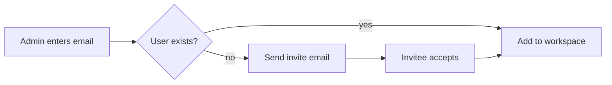
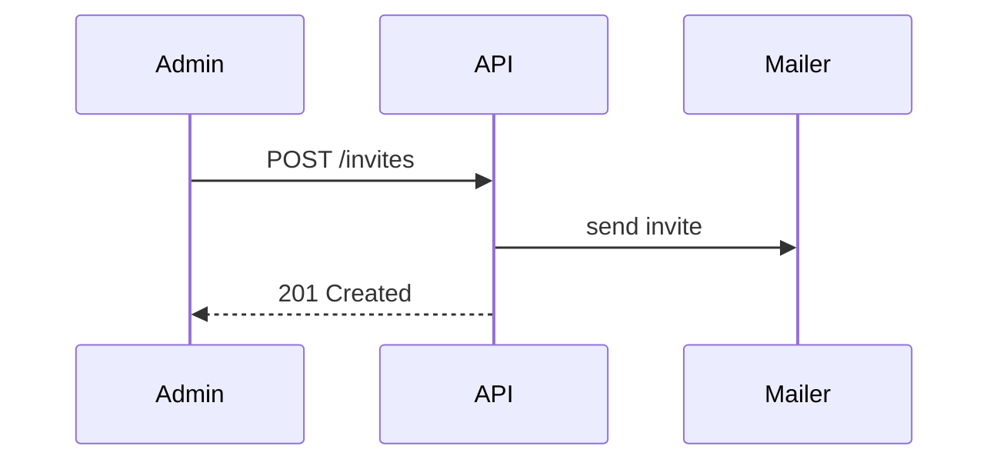
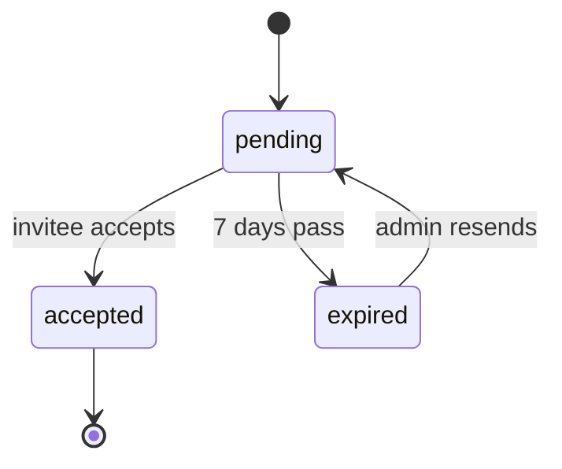
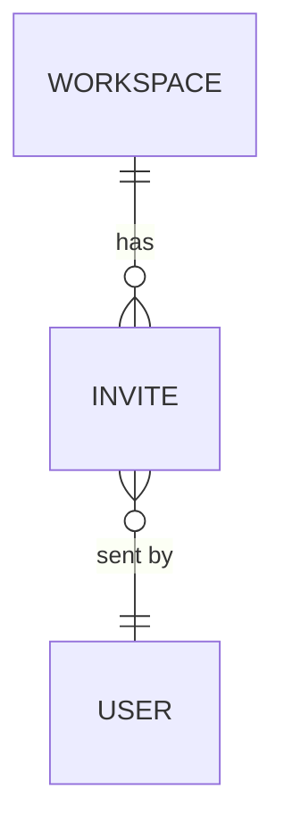

# Visuals

Feature docs should be understandable at a glance. Use a visual whenever it explains faster than a paragraph.

## Which visual

| To show | Use |
|---|---|
| What the user does, step by step, with branches | Mermaid `flowchart` |
| Who calls whom, in what order (services, APIs, jobs) | Mermaid `sequenceDiagram` |
| Entities and their relations | Mermaid `erDiagram` |
| A record's lifecycle (statuses and transitions) | Mermaid `stateDiagram-v2` |
| Module or type structure | Mermaid `classDiagram` |
| Concrete data | Markdown table, or a JSON/YAML block with realistic values |
| What changed in data or UI | before/after table |
| Rules with several inputs | decision table |

## Examples

Flow:

Interaction:

Lifecycle:

Data:

Concrete example:

| email | status | sent_at | expires_at |
|---|---|---|---|
| ana@acme.com | pending | 2026-11-04 | 2026-11-11 |
| rui@acme.com | expired | 2026-10-20 | 2026-10-27 |

## Guidelines

- One idea per diagram. Past ~15 nodes, split it.
- Use the glossary's terms for node and participant names.
- Label every branch and transition.
- Quote labels with special characters (`A["Pay (card)"]`).
- No styling or colours; they break across themes and renderers.
- Example data is realistic but fake: no real people, emails, or secrets.
- Put a one-line caption or walkthrough after each diagram.
