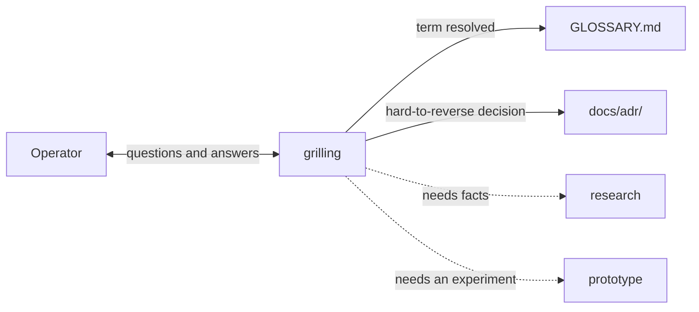
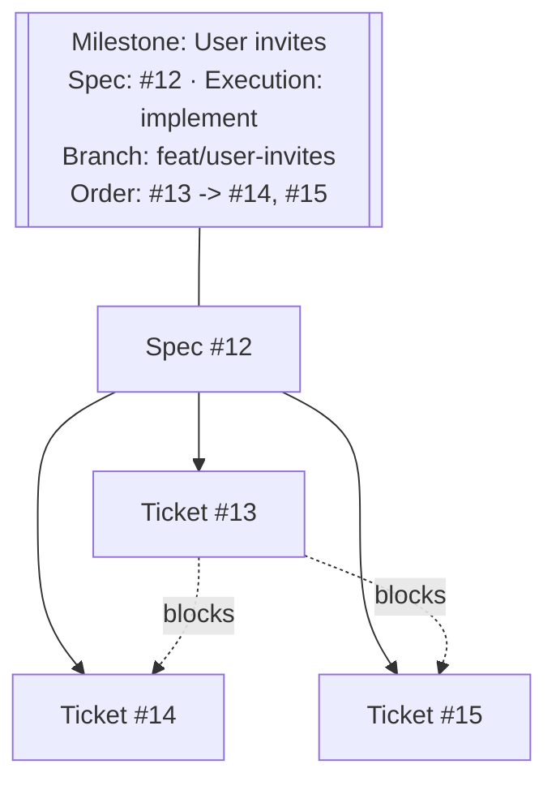
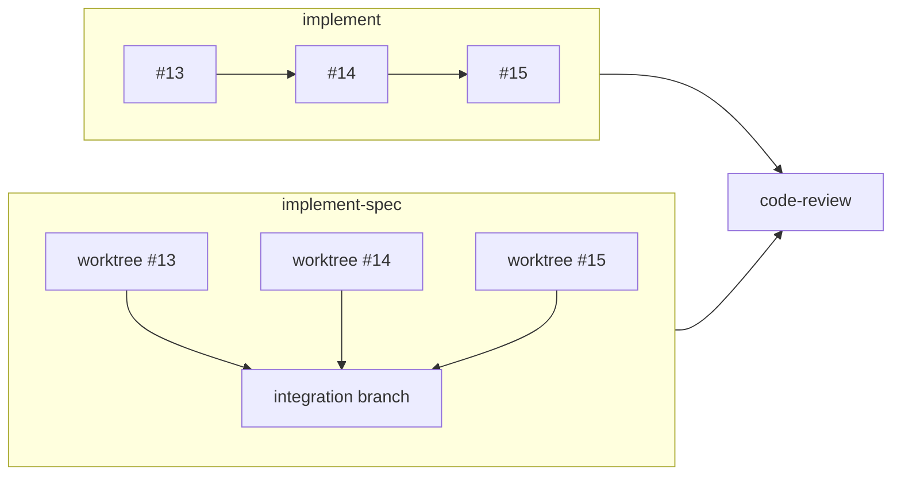
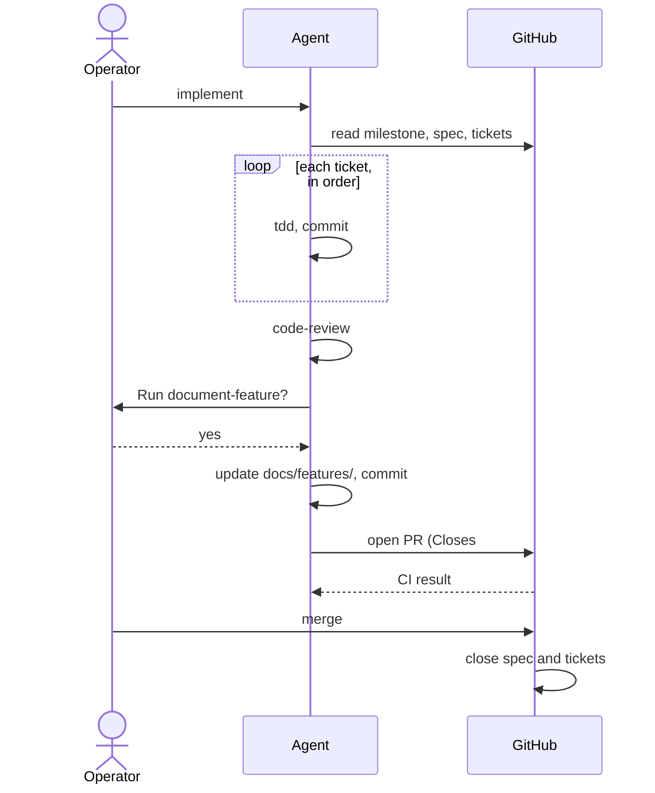

# Development workflow

How a feature goes from idea to merge. Skills marked _(user)_ are invoked by the operator by name; the others are reached by the model, usually through another skill.

```mermaid
flowchart LR
  A([Feature idea]) --> S1[1. Align<br/>grill-with-docs]
  S1 --> S2[2. Spec<br/>to-spec]
  S2 --> M{Execution<br/>mode?}
  M -- recorded in milestone --> S3[3. Tickets<br/>to-tickets]
  S3 --> S4[4. Reset context]
  S4 --> S5[5. Implement<br/>implement / implement-spec]
  S5 --> R[code-review]
  R --> Q{Run<br/>document-feature?}
  Q -- yes --> S6[6. Document<br/>document-feature]
  Q -- no --> S7
  S6 --> S7[7. PR, CI, merge<br/>pr]
  S7 --> Z([Spec and tickets closed])

  classDef align fill:#dbeafe,stroke:#2563eb,color:#1e3a8a
  classDef spec fill:#ede9fe,stroke:#7c3aed,color:#4c1d95
  classDef tickets fill:#fce7f3,stroke:#db2777,color:#831843
  classDef reset fill:#f3f4f6,stroke:#6b7280,color:#1f2937
  classDef implement fill:#fef3c7,stroke:#d97706,color:#78350f
  classDef document fill:#dcfce7,stroke:#16a34a,color:#14532d
  classDef ship fill:#ccfbf1,stroke:#0d9488,color:#134e4a
  classDef endpoint fill:#ffffff,stroke:#9ca3af,color:#111827

  class S1 align
  class S2,M spec
  class S3 tickets
  class S4 reset
  class S5,R implement
  class Q,S6 document
  class S7 ship
  class A,Z endpoint
```

Colors mark the phase: blue align, purple spec, pink tickets, grey reset, amber implement and review, green document, teal ship.

Each step leaves something behind that the next one reads:

| Step | Produces |
|---|---|
| 1. Align | terms in `GLOSSARY.md`, ADRs in `docs/adr/` |
| 2. Spec | spec issue, milestone (the PRD) with execution mode |
| 3. Tickets | sub-issues with blocking edges, order in the milestone |
| 5. Implement | code and tests on a branch, review report |
| 6. Document | `docs/features/<feature>/` updated, `CHANGELOG.md` entry |
| 7. PR | PR that closes the spec and tickets |

## 1. Align: `grill-with-docs` _(user)_

The operator brings the feature. The agent interviews them (`grilling`) until the scope is clear, and records decisions as it goes (`domain-modeling`): terms in `GLOSSARY.md`, hard-to-reverse choices as ADRs in `docs/adr/`.

When a question needs outside facts or a quick experiment, the agent can use `research` or `prototype`.

## 2. Spec: `to-spec` _(user)_

The agent turns the conversation into a spec and publishes it as a GitHub issue, inside a new milestone (the PRD). It then asks the operator for the **execution mode** (`implement` or `implement-spec`) and records it in the milestone description. See [agents/issue-tracker.md](../agents/issue-tracker.md).

## 3. Tickets: `to-tickets` _(user)_

The agent breaks the spec into vertical-slice tickets with blocking edges and publishes them as sub-issues of the spec, in the same milestone. It then fills in the order in the milestone description.

What ends up on GitHub after steps 2 and 3:

## 4. Reset context

Start a fresh session. No separate plan is written: the milestone description is the short execution note (spec, mode, branch, order), and the tickets carry the details.

## 5. Implement: `implement` or `implement-spec` _(user)_

Use the mode recorded in the milestone, passing the spec issue.

- `implement`: one agent works the tickets in order on the current branch.
- `implement-spec`: one subagent per ticket in parallel worktrees, merged into an integration branch.

Both build with `tdd` (which uses `codebase-design`) and finish with `code-review`, which checks the diff against the spec and the rules in `.agents/rules/`.

## 6. Document: `document-feature`

As soon as the agent finishes implementing the spec's last ticket (after `code-review`, before the PR; the tickets themselves only close on merge), it **always asks** the operator whether to run `document-feature`, and runs it on confirmation. It does not skip the question or run the skill unasked.

The skill updates `docs/features/<feature>/` to describe what was built (README, technical notes, Mermaid diagrams, concrete examples) and adds a `CHANGELOG.md` entry with the date, spec, milestone, and tickets. See [ADR-0001](../adr/0001-feature-docs-in-docs-features.md) and the [document-after-implementation](../../.agents/rules/document-after-implementation.md) rule.

## 7. PR, CI, merge

The agent writes the PR body with `pr`, opens the PR with a Conventional Commits title that closes the spec and tickets, waits for CI (if any), and the operator merges.

The operational loop from implementation to merge, by who acts:

## Outside the main flow

- `diagnosing-bugs`: when something is broken, failing, or slow.

## Always

- Commits and PR titles follow [Conventional Commits](../../.agents/rules/conventional-commits.md).
- Decisions are documented: ADRs in `docs/adr/`, vocabulary in `GLOSSARY.md`, execution notes in the milestone, feature behaviour and history in `docs/features/`.
